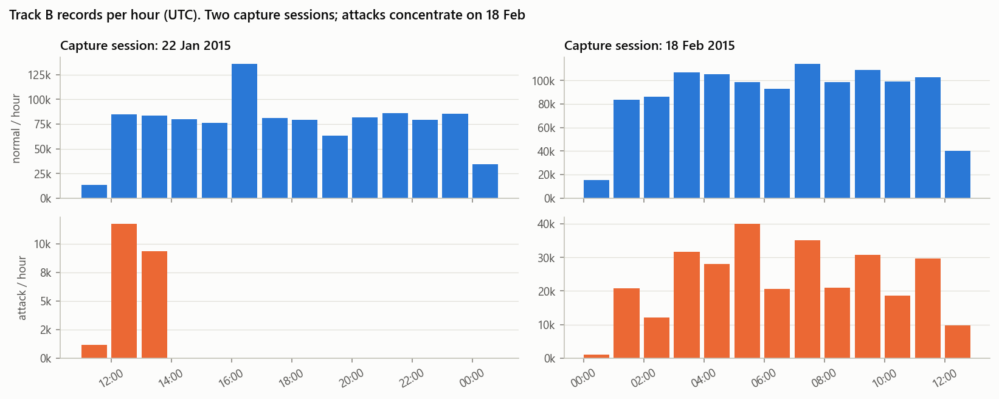
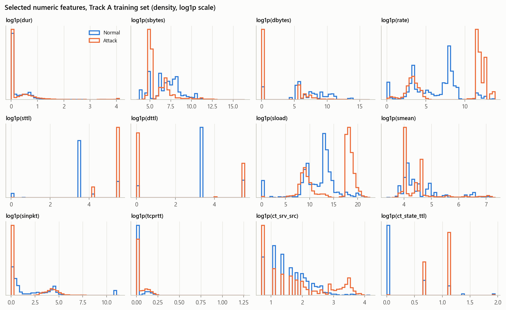
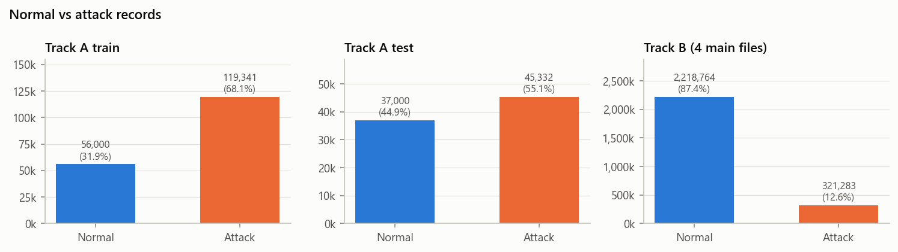
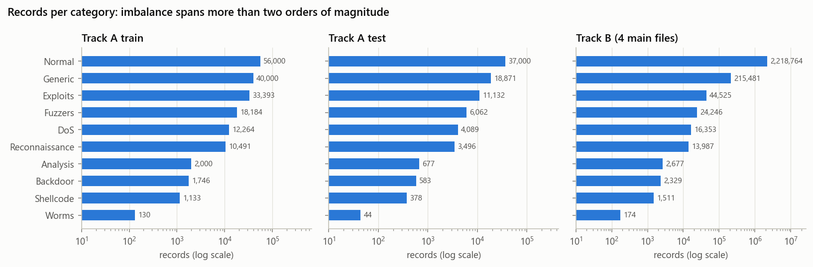
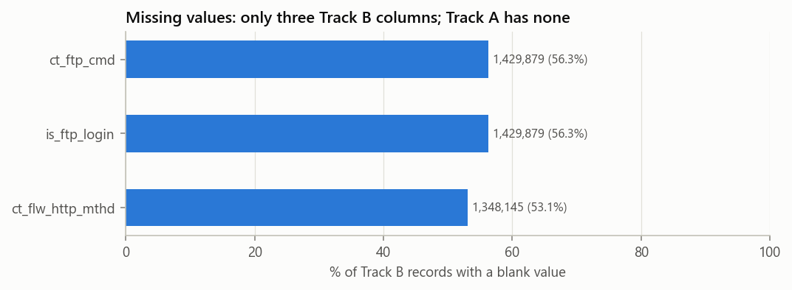
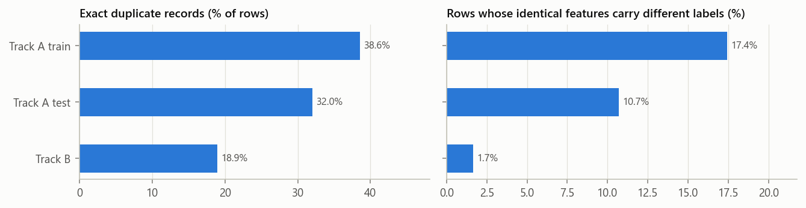

# UNSW-NB15 Dataset Profile (Phase 1)

Every number in this document was measured from the downloaded files by
`scripts/profile_dataset.py` (results in `reports/dataset/profile.json`).
Nothing is copied from online descriptions except where a section says
"official documentation".

## 1. Background and official source

UNSW-NB15 was created in 2015 by Nour Moustafa and Jill Slay in the Cyber
Range Lab of the Australian Centre for Cyber Security (UNSW Canberra). The
IXIA PerfectStorm tool generated a mix of real normal traffic and synthetic
attacks; 100 GB of packets were captured with tcpdump, and Argus, Bro-IDS
and twelve purpose-written algorithms turned them into flow records with
49 attributes including the class labels.

- Official page: <https://research.unsw.edu.au/projects/unsw-nb15-dataset>
  (last updated 2 June 2021).
- Official download: a UNSW SharePoint folder linked from that page. **It
  returned HTTP 403 to automated access and could not be used** (see §2).
- Official documentation states: 2,540,044 records in four CSV files; a
  training set of 175,341 records and a testing set of 82,332 records; nine
  attack families (Fuzzers, Analysis, Backdoors, DoS, Exploits, Generic,
  Reconnaissance, Shellcode, Worms).

## 2. Files acquired and their origin

### 2.1 Source: third-party mirrors (not a direct official download)

With the project owner's approval, the files were obtained from Kaggle
because the official SharePoint download returned HTTP 403.

| | Primary mirror | Cross-check mirror |
|---|---|---|
| URL | <https://www.kaggle.com/datasets/mrwellsdavid/unsw-nb15> | <https://www.kaggle.com/datasets/alextamboli/unsw-nb15> |
| Uploader (Kaggle display name) | Mr Wells David | alextamboli |
| Version | 1 ("Initial release", 29 Jan 2019) | current version (archive entries dated 19 Mar 2023) |
| Kaggle licence field | "Unknown" | not stated |
| Archive SHA-256 | `d923de23e2378ff9e750f37d38fa60828eda33d8a1bd481a752f64930bc4cec6` | `12015557a7b96856cc614a7479684f9613fe25c64d9d9c197862ff76bacb20d0` |
| Downloaded | 15 Nov 2026 (20:51 UTC), anonymous Kaggle API | 15–16 Nov 2026 |
| Files used | 8 CSVs (all except the ground-truth table) | `NUSW-NB15_GT.csv` and the official description PDF only |

Both archives are kept, unopened, in `data/raw/unsw_nb15/_mirror_archive/`.
The CSVs were extracted unchanged and set read-only.

### 2.2 Verification of provenance

1. **Independent copies agree byte for byte.** The two mirrors were uploaded
   four years apart by different people; all eight files they share have
   identical SHA-256 checksums.
2. **Structure matches the official documentation.** The features file lists
   the documented 49 attributes; every one of the 2,540,047 main-file records
   has exactly 49 fields; the nine documented attack families are present.
3. **Counts match the official documentation** where it gives them: 321,283
   attack records in the main files, and per-category totals identical to
   the official `UNSW-NB15_LIST_EVENTS.csv` for all nine families
   (Generic 215,481 … Worms 174). The training/testing files have exactly
   175,341 and 82,332 records with the class counts reported in the
   literature.
4. **UNSW's own description PDF** (in the cross-check mirror) confirms the
   file names, the record totals and the training/testing sizes.

### 2.3 Differences from the official source

| # | Difference | Decision |
|---|---|---|
| 1 | **Training/testing filenames are swapped.** `UNSW_NB15_training-set.csv` has 82,332 records and `UNSW_NB15_testing-set.csv` has 175,341, the reverse of the official documentation. Both mirrors are identical, so the swap predates them (it may exist in the official share; this could not be checked). | Approved by the project owner: follow the official documentation by **content**. The 175,341-record file is the Track A training set, the 82,332-record file the test set. Files keep their names on disk; code resolves them by SHA-256 (`deepshield/data/files.py`). |
| 2 | Main files hold **2,540,047** records, 3 more than the documented 2,540,044. All 3 extra are normal (2,218,764 vs 2,218,761 in LIST_EVENTS). | Kept unchanged and documented; they cannot be identified individually. Effect is negligible (0.0001 %). |
| 3 | The primary mirror lacks the ground-truth table. | `NUSW-NB15_GT.csv` taken from the cross-check mirror (`_mirror2_alextamboli/`). Its name carries the same `NUSW` prefix as the features file. Used only for reference. |
| 4 | The features file is named `NUSW-NB15_features.csv` (the official page says `UNSW-NB15_features.csv`; the PDF says `UNSW-NB15_freatures.csv`). | Content verified; name kept. |

### 2.4 File inventory

| File (as delivered) | Role in this project | Records | Bytes | SHA-256 |
|---|---|---:|---:|---|
| `UNSW_NB15_testing-set.csv` | **Track A training set** | 175,341 | 32,293,018 | `bec7dd5e…48fa` |
| `UNSW_NB15_training-set.csv` | **Track A test set** | 82,332 | 15,380,800 | `734fe664…a559` |
| `UNSW-NB15_1.csv` | Track B, part 1 | 700,001 | 168,979,718 | `7d851bbe…b511` |
| `UNSW-NB15_2.csv` | Track B, part 2 | 700,001 | 165,221,021 | `6130ad02…cacf8` |
| `UNSW-NB15_3.csv` | Track B, part 3 | 700,001 | 154,588,103 | `ae990a96…f640` |
| `UNSW-NB15_4.csv` | Track B, part 4 | 440,044 | 97,588,754 | `cdf56369…96a` |
| `NUSW-NB15_features.csv` | Column names/descriptions for Track B | 49 | 4,044 | `c55f19cc…afce` |
| `UNSW-NB15_LIST_EVENTS.csv` | Official per-category event counts | 207 + total row | 4,639 | `5b40f812…97f2` |
| `_mirror2_alextamboli/NUSW-NB15_GT.csv` | Ground-truth attack table (reference) | 174,347 | 86,426,111 | `6d27542c…b1a8` |

Full checksums: `deepshield/data/files.py`. `scripts/validate_dataset.py`
re-verifies presence, size and checksum of every file.

## 3. Dataset structure: two experimental tracks

| | Track A: official partition | Track B: four main files |
|---|---|---|
| Files | training + testing sets | `UNSW-NB15_1..4.csv` |
| Records | 175,341 train / 82,332 test | 2,540,047 |
| Header row | yes | no (names from features file) |
| Columns | 45 = `id` + 42 features + `attack_cat` + `label` | 49 = 6 identity/time + 41 features + `attack_cat` + `Label` |
| IPs, ports, timestamps | **no** | yes |
| Used for | RF, Isolation Forest, MLP, CNN, Autoencoder benchmark; leave-one-class-out | LSTM (chronological sequences); dashboard replay |

**Column differences.** Five features are spelled differently but measure the
same quantity: `smeansz`→`smean`, `dmeansz`→`dmean`, `res_bdy_len`→
`response_body_len`, `Sintpkt`→`sinpkt`, `Dintpkt`→`dinpkt` (plus
capitalisation: `Sload`, `Spkts`, …). `rate` exists only in Track A; `id`
only in Track A; `srcip`, `sport`, `dstip`, `dsport`, `stime`, `ltime` only in
Track B. The features file contains a typo, `ct_src_ ltm`.

**Relationship between tracks.** The official description calls the
training/testing sets "a partition from this data set", but the partition
has no identifier linking it to main-file rows and adds `rate`. The tracks are
therefore never mixed: Track A models are trained and evaluated only on
Track A; Track B models only on Track B.

**Track B time structure.** Two capture sessions: 22 Jan 2015 11:49 –
23 Jan 00:xx UTC (1,087,203 records, 22,215 attacks, all between 11:49 and
14:00) and 18 Feb 2015 00:xx – 12:21 UTC (1,452,844 records, 299,068 attacks).
Within each file, records are sorted by `ltime` (end time); `stime`
decreases between consecutive rows in 12–15 % of rows.


## 4. Features and labels

**Targets.** `label` (0 normal, 1 attack) and `attack_cat` (Normal + nine
attack categories). In both tracks `label == 0` exactly when the category is
Normal (0 inconsistent records).

**Feature types (Track A, 42 features).**

| Group | Features |
|---|---|
| Categorical (3) | `proto` (133 train levels), `service` (13), `state` (9) |
| Basic flow | `dur`, `spkts`, `dpkts`, `sbytes`, `dbytes`, `rate`, `sttl`, `dttl`, `sloss`, `dloss` |
| Content / load / TCP | `sload`, `dload`, `smean`, `dmean`, `trans_depth`, `response_body_len`, `swin`, `dwin`, `stcpb`, `dtcpb` |
| Timing | `sinpkt`, `dinpkt`, `sjit`, `djit`, `tcprtt`, `synack`, `ackdat` |
| Connection counters (`ct_*`) | `ct_srv_src`, `ct_srv_dst`, `ct_dst_ltm`, `ct_src_ltm`, `ct_src_dport_ltm`, `ct_dst_sport_ltm`, `ct_dst_src_ltm`, `ct_state_ttl`, `ct_flw_http_mthd`, `ct_ftp_cmd` |
| Flags | `is_ftp_login`, `is_sm_ips_ports` |

All 39 numeric features are stored as integers or floats; full per-feature
descriptions are in `NUSW-NB15_features.csv` (copied into
`profile.json → features_file.descriptions`). Most numeric features are
extremely right-skewed (e.g. `sbytes`: median 430, max 12,965,233, skew 45;
`response_body_len` is 0 in 93.6 % of records), and roughly half of the
records (UDP and other non-TCP flows) have zeros for all TCP-specific
features.


## 5. Attack categories

| Category | What it represents (official definitions, paraphrased) |
|---|---|
| Generic | Attacks against block ciphers regardless of their structure |
| Exploits | Exploitation of known vulnerabilities in software/OS |
| Fuzzers | Feeding random data to crash a program or network service |
| DoS | Attempts to make a host or service unavailable |
| Reconnaissance | Information-gathering probes and scans |
| Analysis | Port scans, spam and HTML-file penetration |
| Backdoor | Bypassing authentication to gain unauthorised access |
| Shellcode | Small code payloads used to exploit vulnerabilities |
| Worms | Self-replicating programs |

The official LIST_EVENTS file splits these into 207 sub-categories, and the
ground-truth table names 7,225 distinct attack signatures; neither level is
available in Track A, so classification is at category level.

## 6. Class distribution

| Category | Track A train | Track A test | Track B |
|---|---:|---:|---:|
| Normal | 56,000 | 37,000 | 2,218,764 |
| Generic | 40,000 | 18,871 | 215,481 |
| Exploits | 33,393 | 11,132 | 44,525 |
| Fuzzers | 18,184 | 6,062 | 24,246 |
| DoS | 12,264 | 4,089 | 16,353 |
| Reconnaissance | 10,491 | 3,496 | 13,987 |
| Analysis | 2,000 | 677 | 2,677 |
| Backdoor | 1,746 | 583 | 2,329 |
| Shellcode | 1,133 | 378 | 1,511 |
| Worms | 130 | 44 | 174 |
| **Attack share** | 68.1 % | 55.1 % | 12.6 % |




Track A is **attack-heavy** (the partition over-samples attacks) while the
full data is 87 % normal. A model's false-positive rate on Track A therefore
understates the alert load it would cause on realistic traffic.

## 7. Data quality

**Track A.** No missing values, no infinite values, no negative values, unique
`id`s. Quirks:

- `is_ftp_login`, described as binary, takes values {0, 1, 2, 4}; it is
  identical to `ct_ftp_cmd` (Spearman ρ = 1.0) in the training set.
- `trans_depth` and `ct_flw_http_mthd` are perfectly rank-correlated.
- `state` levels `ACC` and `CLO` occur only in the test set (5 records).

**Track B.** Repaired while parsing (`deepshield/data/loaders.py`), each repair
counted in `data/interim/track_b/parse_stats.json`:

- UTF-8 byte-order mark at the start of `UNSW-NB15_1.csv`.
- Ports: 9 `-` values (no port) and 303 hexadecimal values (e.g. `0x000b`);
  2 hexadecimal destination "ports" exceed 65,535 (invalid, kept as parsed).
- `attack_cat` padded with spaces (`" Fuzzers "`), spelled both `Backdoor`
  and `Backdoors`, and empty for normal traffic.

**The ct_\* counters cannot be reproduced.** The features file defines, for
example, `ct_src_ltm` as the number of connections from the same source
"in 100 connections according to the last time". Recomputing it on the first
100,000 records of file 1 (which is sorted by `ltime`):

| Window definition | ct_src_ltm match | ct_dst_ltm match | ct_dst_src_ltm match |
|---|---:|---:|---:|
| previous 100 records (incl. itself) | 5.0 % | 5.1 % | 41.2 % |
| next 100 records | 5.0 % | 5.2 % | 41.5 % |
| fixed blocks of 100 | 4.6 % | 5.1 % | 46.5 % |

No tested definition reproduces the released values, which were presumably
computed on the internal Argus/Bro record stream before the CSVs were
assembled. Some counters are **larger than the number of earlier records
with the same key** (e.g. the very first record has `ct_src_ltm = 3`), which
is impossible for a backward-looking window: the counters partly count
*later* connections. Consequence for Track B: a gap between chronological
blocks reduces, but **cannot be proven to eliminate**, leakage through
these features. Phase 2 uses a time gap and reports this limitation.

## 8. Missing values and duplicates

**Missing values.** Track A: none. Track B: only three columns, from file 2
onwards, where the field is blank:

| Column | Blank in Track B |
|---|---:|
| `ct_flw_http_mthd` | 1,348,145 (53.1 %) |
| `is_ftp_login` | 1,429,879 (56.3 %) |
| `ct_ftp_cmd` | 1,429,879 (56.3 %) |



**Duplicates.**

| | Track A train | Track A test | Track B |
|---|---:|---:|---:|
| Exact duplicate records (excluding `id`) | 67,601 (38.6 %) | 26,387 (32.0 %) | 480,633 (18.9 %) |
| Duplicate feature vectors | 74,301 | 28,386 | 523,185 |
| Feature-identical groups with conflicting categories | 1,772 groups / 30,528 rows | 575 / 8,809 | 2,579 / 42,282 |

Duplicates are concentrated in Generic (39,169 of the 74,301 training
duplicates) and DoS/Exploits: many automated attack flows are bit-identical.
**Cross-split overlap:** 8,541 test records (10.4 %) have a feature vector that
also occurs in the training set (DoS 2,004, Exploits 1,802, Generic 1,722,
Normal 1,472, …). Conflicting groups set a hard ceiling on achievable
accuracy: the same feature vector is labelled, e.g., both DoS and Exploits.



## 9. Class imbalance

In the Track A training set the majority class (Normal, 56,000) outnumbers
the smallest (Worms, 130) by **431 : 1**; four attack classes have at most
2,000 training records each. In Track B the ratio Normal : Worms is
12,752 : 1. Accuracy is therefore uninformative for the minority classes;
macro-averaged F1 and per-class recall are the primary metrics.

## 10. Preprocessing needs (inputs to Phase 2)

1. Resolve Track A files by checksum; never mix tracks.
2. Encode `proto` (133 levels, long tail), `service`, `state`; unseen levels
   (e.g. `state = ACC/CLO` in test) must map to an "other" bucket.
3. Heavy-tailed numerics: `log1p` before standardisation (fitted on training
   data only).
4. Track B blanks in `ct_flw_http_mthd`/`is_ftp_login`/`ct_ftp_cmd`: impute
   (training statistics) and add missing-indicator flags, because blankness
   is file-dependent rather than random.
5. Keep duplicates in training data (they are real repeated flows) but report
   test performance also on the de-duplicated test subset that has no
   feature-vector overlap with training.
6. Imbalance: class weighting; resampling only if justified by validation.
7. Track B chronological split with a time gap; IPs/ports/timestamps used for
   ordering and grouping only, never as model inputs.

## 11. Licensing and citation

Official terms (verbatim): *"Free use of the UNSW-NB15 dataset for academic
research purposes is hereby granted in perpetuity. Use for commercial
purposes should be agreed by the authors. Nour Moustafa and Jill Slay have
asserted their rights under the Copyright. To whom intend the use of the
UNSW-NB15 dataset have to cite the above five papers."*

- This academic project is permitted use.
- **Redistribution: unresolved.** The terms do not address it, and the Kaggle
  mirrors state no licence. The dataset is therefore **not** committed to git
  or included in the submission package; users download it themselves
  (`docs/dataset_setup.md`).
- Required citations:
  1. N. Moustafa and J. Slay, "UNSW-NB15: a comprehensive data set for network
     intrusion detection systems (UNSW-NB15 network data set)," *MilCIS*, 2015.
  2. N. Moustafa and J. Slay, "The evaluation of Network Anomaly Detection
     Systems: Statistical analysis of the UNSW-NB15 data set and the comparison
     with the KDD99 data set," *Information Security Journal: A Global
     Perspective*, 2016.
  3. N. Moustafa, J. Slay and G. Creech, "Novel geometric area analysis
     technique for anomaly detection using trapezoidal area estimation on
     large-scale networks," *IEEE Transactions on Big Data*, 2017.
  4. N. Moustafa, G. Creech and J. Slay, "Big data analytics for intrusion
     detection system: statistical decision-making using finite Dirichlet
     mixture models," in *Data Analytics and Decision Support for
     Cybersecurity*, Springer, 2017.
  5. M. Sarhan, S. Layeghy, N. Moustafa and M. Portmann, "NetFlow Datasets for
     Machine Learning-Based Network Intrusion Detection Systems," *BDTA/WiCON*,
     2020.

## 12. Limitations

- **Mirror provenance.** The files come from third-party mirrors; agreement
  between two independent mirrors and with every official count is strong but
  not cryptographic proof of identity with the official share.
- **Synthetic testbed.** Attacks were generated by IXIA PerfectStorm from a
  single attacker subnet (`175.45.176.0/24`, 4 hosts produce all 321,283 attack
  records); only 43 source IPs exist. Results may not transfer to real
  networks, and per-host sequence models (LSTM) risk learning host identity.
  Label purity per source IP: 39 IPs are purely normal; the 4 attacker IPs
  are 71–92 % attack.
- **Age.** Traffic from 2015; no modern encrypted-C2 or DGA patterns.
- **Label noise.** Conflicting labels for identical feature vectors (§8).
- **Non-reproducible ct_\* features** with forward-looking counts (§7).
- **Track A distribution shift.** The official partition is attack-heavy and
  its train/test class mixes differ (68 % vs 55 % attacks).

## Reproduction

```powershell
.venv\Scripts\python.exe scripts\validate_dataset.py      # presence, sizes, SHA-256, record counts
.venv\Scripts\python.exe scripts\profile_dataset.py       # -> reports\dataset\profile.json
.venv\Scripts\python.exe scripts\make_dataset_figures.py  # -> reports\figures\dataset\*.png
.venv\Scripts\python.exe -m pytest tests\test_data.py
```
